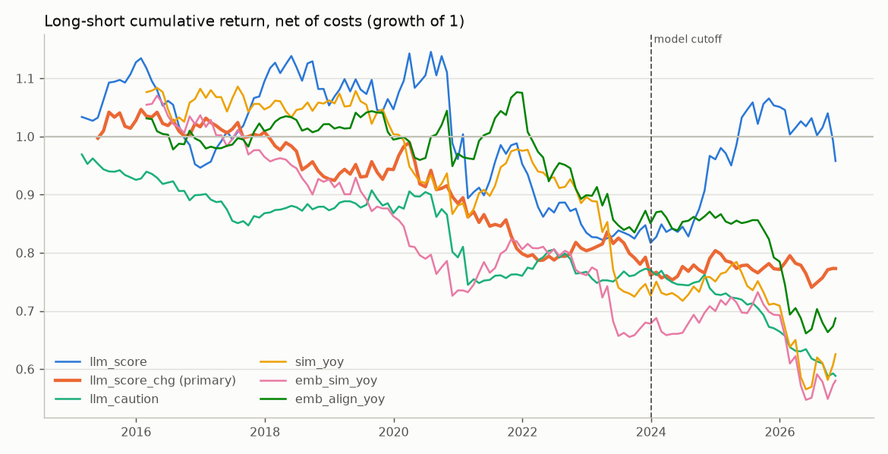
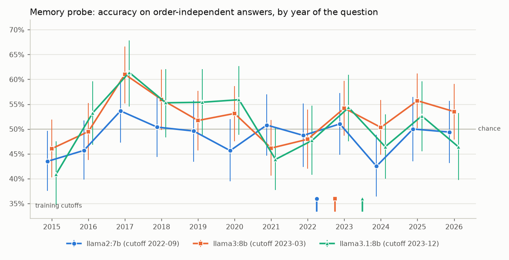

# Filing signals

[](https://github.com/chensirui3/LLM-filing-signals/actions/workflows/tests.yml)

Do signals that a local LLM extracts from SEC filings predict stock returns, and
can an apparent result be separated from the model recalling outcomes it saw
during training?

The pipeline downloads 10-K and 10-Q filings from SEC EDGAR, scores the
Management's Discussion and Analysis (MD&A) section with a local model
(Llama 3.1 8B through Ollama), and evaluates the scores with a point-in-time
backtest. It runs on a single machine and uses only free data.

The project also includes a tool that reports what changed in a company's
Risk Factors from one 10-K to the next. A
[live demo](https://chensirui3.github.io/LLM-filing-signals/) runs in the
browser with nothing to install.

## Look-ahead bias in LLM backtests

A language model trained on text up to December 2023 has been exposed to news
about how large companies performed before that date. Given a 2019 filing, it
may rate the text favourably because it has seen how the company performed in
2020, not because of anything in the filing. A backtest over the pre-cutoff
period cannot by itself distinguish this look-ahead effect from genuine
predictive content. This project tests for the effect directly with five
checks:

| Check | What it does | Where |
|---|---|---|
| Cutoff split | Reports every result separately before and after the model's training cutoff. Only the post-cutoff results are free of possible look-ahead. | `backtest.split_stats` |
| Memory probe | Gives the model no filing text, only two company names and a date, and asks which stock had the higher return over the following three months. Accuracy above chance before the cutoff but not after it would indicate memorised outcomes. Each pair is asked in both orders and only order-independent answers are scored. The probe is run on three Llama versions with different training cutoffs. | `leakage.run_memory_probe` |
| Memory controls | Tests whether the memory probe's accuracy is specific to the date or reflects a general preference for certain companies: how often the model picks the larger company, and how accurate its picks are when scored against other dates. | `leakage.memory_controls` |
| Identity probe | Masks the company name and years, then asks the model to name the company. Measures whether anonymisation prevents the model from identifying the filer. | `leakage.identity_probe` |
| Raw vs anonymised | Scores every filing twice, with and without the company masked, and tests whether the difference between the two scores predicts returns before the cutoff. | `robustness.variant_comparison` |

## Results

Sample: the 500 largest US filers, 20,993 scored filings from January 2015 to
November 2026. Model: Llama 3.1 8B, training cutoff December 2023. Full tables
are in [reports/report_raw.md](reports/report_raw.md). The anonymised scoring
was run on the 100 largest companies only;
[reports/report_anon.md](reports/report_anon.md) covers those.

**The primary signal does not predict returns.** The pre-declared primary
signal, the change in the LLM score, has a rank IC of 0.003 (t = 0.3) against
63-day returns and a net long-short Sharpe ratio of -0.39 (-0.54 before the
cutoff and 0.13 after, neither significant). No signal has a rank IC that
reaches |t| = 2 at any horizon. The two similarity signals based on Lazy
Prices do not reproduce the published effect in this large-cap sample: their
portfolios lose money, though not significantly (t = -1.4 and -1.8). Varying
the entry lag (0 to 5 days) or trading costs (0 to 25 bps) does not change any
conclusion. Ranking companies within their industry makes the primary signal
slightly worse (Sharpe -0.58, t = -2.0), and no signal other than
`llm_caution` has a significant return after adjusting for the Fama-French
five factors and momentum. The smallest rank IC the sample would reliably detect is between
0.02 and 0.04, depending on the signal, so effects of the size usually
reported for text signals are not ruled out.



**One secondary signal is significant with the wrong sign.** `llm_caution` was
expected to be positive: companies whose MD&A the model rates as confident and
free of liquidity concerns should do better. Its long-short portfolio instead
loses 4.3% a year (Sharpe -0.83, t = -2.9), and loses most after the cutoff
(Sharpe -2.17, t = -3.7, 35 months). The loss is spread across nine of the
twelve years, comes from the 400 smaller companies and not from the 100
largest (Sharpe -0.19 there), and is not explained by the signal's
correlation with size or volatility, both close to zero. It is not an
industry effect either: when each company is ranked against others in its
industry, so that the portfolio takes no position on industries, the result
is unchanged (Sharpe -0.88, t = -3.0; after the cutoff -2.00, t = -3.4). Nor
is it exposure to known risk factors: regressed on the Fama-French five
factors and momentum, the portfolio has small loadings and an unexplained
return of -4.1% a year (t = -2.8), or -3.6% (t = -2.6) for the
within-industry version. This signal was not
the pre-declared one, it is one of six, and it is the signal most affected by
reading only the first part of each MD&A. It is reported here as an
observation that would need testing on other data, not as a tradable result.

**The scores carry real information, but the market already has it.** The LLM
tone score has a rank IC of 0.083 (t = 5.2) with the stock's market-adjusted
return over the 63 trading days *before* the filing, and this holds after the
training cutoff (0.066, t = 3.6). It is also correlated with the return on
the filing day and the day after (0.036, t = 4.3). Against the 63 days after
entry the IC is 0.005 (t = 0.4). The model reads the reported quarter
correctly; by the time the filing can be traded, that information is in the
price.

**The memory probe finds no memorised outcomes.** With no filing text,
Llama 3.1 picks the better performer of two stocks 51.5% of the time before
its cutoff (n = 1,852, z = 1.3) and 48.3% of the time after it (n = 623);
the difference is not significant (z = 1.4). Llama 3 8B scores 51.2% before
its cutoff and 53.3% after it, and Llama 2 is at or below 49% in both
periods. Accuracy does vary by year, from 41% to 61%, but the three models
rise and fall in the same years whatever their cutoff, which indicates that
the models share preferences for certain kinds of company and that those
preferences paid off in some years and not in others. An earlier version of
this study, on the 100 largest companies only, measured 57% before the cutoff
and 55% after it: the models favour well-known companies that went on to
become the largest, and the effect disappears in a broader universe.



**Anonymisation does not conceal the company.** From text with the name,
ticker and years masked, the model names the correct company 73% of the time
(293 excerpts).

**There is no evidence that memorised outcomes inflate the backtest.** If the
scores drew on the model's knowledge of subsequent events, they would predict
returns before the cutoff. They do not: the three LLM-scored signals have
pre-cutoff net Sharpe ratios of -0.21, -0.54 and -0.51. For the 100 largest
companies, raw and anonymised scores also agree closely (correlation 0.94),
and the gap between them does not predict returns before the cutoff (rank IC
between -0.02 and -0.03, t between -1.2 and -1.8). This second comparison is
weak evidence on its own, because the identity probe shows that anonymisation
does not conceal the company. In the 100-company sample the tone score was
correlated with the return around the filing date before the cutoff and not
after it, which could have indicated the model recalling how filings were
received. With 500 companies the correlation is present in both periods
(0.040, t = 4.0 before; 0.025, t = 1.7 after), so that difference is
attributed to sampling variation. These results apply to this model and
prompt.

**Reading only the start of each MD&A does not change the conclusions.** For
3,559 longer filings of the 100 largest companies, every chunk was scored.
The tone score from the first three chunks has a correlation of 0.83 with the
score from the whole section, and both show the same pattern: correlated with
returns before the filing and not with returns after it.

## Risk-factor comparison tool

The same pipeline supports a second tool, which reports what changed in a
company's Risk Factors section since the previous year's 10-K.

```powershell
.venv\Scripts\python -m fsig riskdiff --ticker NVDA --year 2023
```

Paragraphs are matched by meaning using embeddings, then classified as
unchanged, edited (shown as a word-level diff), rewritten, added or removed.
The local LLM writes a one-line summary of each added and removed risk. Each
paragraph is shown under its risk-factor heading; headings are recognised by
their bold or italic formatting in the filing, because many are full sentences
as long as a short paragraph. Paragraphs split by a page break are rejoined,
and sections whose text is hard-wrapped into short lines are reflowed into
paragraphs. Examples:

- [NVIDIA, 10-K filed February 2023](reports/riskdiff_NVDA_2023.md)
  ([demo](https://chensirui3.github.io/LLM-filing-signals/#NVDA/2023)): the
  new US export licence requirements for China and the transfer of operations
  out of China appear as added risks.
- [Boeing, 10-K filed January 2020](reports/riskdiff_BA_2020.md)
  ([demo](https://chensirui3.github.io/LLM-filing-signals/#BA/2020)): the
  737 MAX grounding and production suspension appear as added risks.
- [Meta, 10-K filed February 2022](reports/riskdiff_META_2022.md)
  ([demo](https://chensirui3.github.io/LLM-filing-signals/#META/2022)): the
  metaverse strategy and blockchain-based payment initiatives appear as added
  risks.

The [live demo](https://chensirui3.github.io/LLM-filing-signals/) covers 97 of
the 100 largest companies in the universe: each of their 10-Ks filed from 2016
to 2026 is compared with the one before it, 947 comparisons in all. General
Electric, Wells Fargo and Citigroup are missing because the parser does not
find a Risk Factors section in their 10-Ks. The comparisons were computed in
advance by `python -m fsig demo`, which took about an hour and a half on one
RTX 4090 and writes them to `docs/data/` (21 MB). The page, `docs/index.html`,
only displays them, so GitHub Pages serves it without any server-side code. A
link to a particular comparison ends in its ticker and year, for example
`#NVDA/2023`.

The Streamlit front end compares any company and year in the universe on
demand. It needs the downloaded filings and a running Ollama server:

```powershell
.venv\Scripts\python -m pip install -e .[app]
.venv\Scripts\python -m streamlit run app.py
```

The similarity threshold that separates "rewritten" from "added" (0.93) was
chosen by inspecting matched pairs for NVIDIA. It was then tested on 120
labelled paragraph pairs from 16 other companies: of the paragraphs the tool
calls rewritten, 90% are rewrites, and it finds 68% of all rewrites; the rest
are reported as added. The sample deliberately over-represents hard cases, and
the labels were assigned by an LLM assistant and spot-checked by the author,
without a full second annotation. See
[reports/riskdiff_validation.md](reports/riskdiff_validation.md); the pairs and
labels are in `validation/riskdiff_pairs.csv`, and `python -m fsig riskeval`
rebuilds the report. The LLM summaries may be inaccurate; the quoted filing
text is authoritative.

## Method

1. **Universe**: the largest US companies in the SEC ticker file that file 10-Ks.
2. **Text**: the MD&A section, located by its `Item` headers, with numeric table
   rows removed. The first 3 chunks of about 3,000 tokens each are scored.
3. **LLM scores**: for each chunk the model returns JSON constrained by a schema:
   tone, outlook, demand and margins (-2 to 2), liquidity stress and uncertainty
   (0 to 2). Temperature 0, fixed seed, responses cached by content hash.
4. **Signals**
   - `llm_score`: mean of tone, outlook, demand and margins
   - `llm_score_chg`: change in `llm_score` from the company's previous filing
     (**primary signal**, declared in `config.yaml` before any results were
     computed)
   - `llm_caution`: minus (liquidity stress + uncertainty)
   - `sim_yoy`: non-LLM baseline, the word-count similarity of the MD&A to the
     same filing a year earlier (Cohen, Malloy and Nguyen, "Lazy Prices",
     Journal of Finance, 2020)
   - `emb_sim_yoy`, `emb_align_yoy`: the same year-over-year comparison using
     embeddings from a local model (`nomic-embed-text`), at whole-document and
     passage level. These test whether semantic comparison adds information
     beyond word counts.
5. **Timing**: a signal becomes tradable at the close of the first trading day
   *after* the filing date. No signal is used before that point.
6. **Evaluation**
   - Rank IC against market-adjusted returns at 5, 21 and 63 trading days,
     computed per calendar quarter and then averaged, with a t-statistic.
   - Monthly-rebalanced top-minus-bottom quintile portfolio, equal-weighted,
     with 10 bps one-way costs charged on turnover. Companies with equal
     scores are split evenly across a quintile boundary, so the result does
     not depend on how ties are ordered.
   - Rank IC against returns before and around the filing, to show whether a
     signal reflects information the market already has.
7. **Memory probe**: 400 random stock pairs per calendar year (4,799 in all),
   each asked in both orders, with the model answering by ticker. Only pairs
   on which the model names the same company in both orders are scored. A pair
   counts as pre-cutoff when its whole three-month window ends before the
   model's cutoff. The cutoffs are those in Meta's model cards: September 2022
   for Llama 2, March 2023 for Llama 3 8B and December 2023 for Llama 3.1.

## Usage

Requires Python 3.11 or later and [Ollama](https://ollama.com). The commands
below are written for Windows; on macOS or Linux, create the environment with
`python3 -m venv .venv` and replace `.venv\Scripts\python` with
`.venv/bin/python`.

```powershell
py -3.12 -m venv .venv
.venv\Scripts\python -m pip install -e .[dev]
copy .env.example .env        # then set EDGAR_USER_AGENT in .env
ollama pull llama3.1:8b
ollama pull nomic-embed-text
ollama pull llama3:8b         # optional: the two older models used only by the memory probe
ollama pull llama2:7b
```

```powershell
.venv\Scripts\python -m fsig all          # universe, download, parse, prices, extract, embed, signals, report
.venv\Scripts\python -m fsig leakage      # memory probe on every installed model, identity probe; added to the reports
.venv\Scripts\python -m fsig extract --variant anon   # optional: score the anonymised text (takes as long as the first scoring run)
.venv\Scripts\python -m fsig signals --variant anon
.venv\Scripts\python -m fsig robustness   # lag, cost, industry and factor checks; raw vs anonymised comparison if both variants exist
.venv\Scripts\python -m fsig demo         # optional: precompute the Risk Factors comparisons shown by the demo page in docs/
.venv\Scripts\python -m pytest
```

Every step caches its output in `data/` and resumes if interrupted. Results
are written to `reports/`. With 500 companies the full run takes about a day
on one RTX 4090: an hour to download 21,000 filings (about 8 GB on disk),
14 hours of scoring, 4 hours of embeddings and an hour of probes. The
published anonymised scores and whole-MD&A scores cover the 100 largest
companies; `--size 100` reproduces that subset.

To install the exact package versions behind the published results, use
`requirements-lock.txt` in place of the second command above:

```powershell
.venv\Scripts\python -m pip install -r requirements-lock.txt
.venv\Scripts\python -m pip install -e . --no-deps
```

### Trial run

A small run exercises every step in 10 to 15 minutes. Setting `FSIG_HOME`
keeps its data and reports in a separate folder, so it does not overwrite the
full results:

```powershell
$env:FSIG_HOME = "quickstart"
.venv\Scripts\python -m fsig all --size 12 --start 2022-01-01
$env:FSIG_HOME = $null
```

With 12 companies the statistics are not meaningful; the run only shows that
the pipeline works.

### Rebuilding the reports without a GPU

The repository includes the filing index, the per-filing signal tables and the
cache of every LLM response (`data/`), which is all the backtest needs apart
from prices. With no Ollama installation and no filings downloaded:

```powershell
.venv\Scripts\python -m fsig prices       # about a minute; downloads from Yahoo Finance
.venv\Scripts\python -m fsig report
.venv\Scripts\python -m fsig report --variant anon
.venv\Scripts\python -m fsig robustness
```

Because prices are downloaded afresh and Yahoo revises adjusted prices, the
rebuilt tables can differ from the published ones in the third decimal place.
Price data is not redistributed here. The leakage step still needs Ollama and
the downloaded filings.

## Limitations

- **Universe selection bias.** Companies are selected by *current* market
  capitalisation, so the sample is tilted towards past winners and excludes
  delisted firms. A long-short portfolio offsets this only in part. Removing
  the bias requires point-in-time index membership and delisting returns (for
  example from CRSP), which are not freely available. Companies are also
  identified by their current SEC registrant: the ticker XOM now belongs to a
  newly registered ExxonMobil holding company with no 10-K filings, so
  ExxonMobil is not in the universe.
- **Limited power.** With 500 companies and about 45 quarters, the smallest
  rank IC the study would detect with 80% power is 0.02 to 0.04. A smaller
  real effect would not be found. The post-cutoff period is under three years
  (35 monthly observations), so estimates there are less precise still. The
  anonymised scoring and the whole-MD&A check cover only the 100 largest
  companies.
- **Section parsing.** The MD&A is found in 96% of 10-Ks and 98% of 10-Qs. The
  parser tries the `Item` header first, then the MD&A title alone (handling
  titles repeated as page headers), then the opening headings used by banks.
  The failures examined, among the 100 largest companies, are mostly companies
  that place the MD&A in a separate annual-report exhibit (IBM, Eaton,
  Progressive and Wells Fargo 10-Ks), which the pipeline does not download. For a few filers located by title (Citi and
  GE 10-Qs) the extracted text begins at the table of contents and therefore
  includes a few thousand characters of headings before the section itself.
  Coverage is printed by the `parse` step.
- **Truncation.** Only the first 9,000 tokens (approximately) of each MD&A are
  scored, which is a median of 47% of the section in a 10-K and 68% in a 10-Q.
  The liquidity discussion usually comes late in the section, so the
  `llm_caution` signal is the most affected: its correlation with the same
  signal built from the whole section is 0.65, against 0.83 for the tone
  score.
- **Price data.** Prices are Yahoo Finance adjusted closes and have not been
  checked against a second source.
- **Returns.** The rank ICs use market-adjusted returns (stock minus SPY),
  not factor-adjusted returns. The long-short portfolios are also regressed
  on the Fama-French five factors and momentum, from Kenneth French's data
  library, which ended in September 2026 when the reports were built; the
  regressions after the cutoff have 33 months for seven coefficients.
  Industries are two-digit SIC groups from each company's current EDGAR
  classification. Borrow costs and market impact are not modelled beyond the
  flat cost assumption.
- **Multiple testing.** Six signals at three horizons give eighteen tests. For
  this reason a single primary signal was declared before any results were
  computed. The `llm_caution` result is one of the remaining tests and was
  also examined by sub-period, so its t-statistics overstate the evidence.
- **Memory probe.** The probe uses one prompt and three models from one
  family, and asks about relative returns only; a model could hold other
  knowledge of later events that this question does not reach. Its accuracy
  interacts with the universe selection bias: among the 100 largest companies
  a model that prefers well-known names is right more often than not, before
  and after its cutoff. Company size in the controls is the current rank, not
  size at the time of the question. Llama 2's fine-tuning data runs
  to July 2023, later than its pretraining cutoff.

## Repository layout

```
config.yaml             experiment definition
src/fsig/edgar.py       universe, filing index, downloads
src/fsig/sections.py    HTML to MD&A and Risk Factors text
src/fsig/extract.py     LLM scoring, anonymisation, response cache
src/fsig/embed.py       chunk embeddings and year-over-year embedding signals
src/fsig/signals.py     per-filing signal table, Lazy Prices baseline
src/fsig/backtest.py    forward returns, rank IC, long-short portfolio
src/fsig/leakage.py     memory and identity probes, memory controls
src/fsig/robustness.py  lag, cost, industry and factor checks; raw vs anonymised comparison
src/fsig/riskdiff.py    year-over-year Risk Factors comparison
src/fsig/report.py      markdown reports and charts
app.py                  browser front end for the Risk Factors comparison
docs/                   static demo page and its precomputed comparisons, served by GitHub Pages
validation/             labelled paragraph pairs for the comparison threshold
tests/                  unit tests for parsing, timing, signals and probes
reports/                generated reports, charts and example comparisons
data/                   filing index, signal tables and LLM response cache (other data is not tracked)
requirements-lock.txt   exact package versions used for the published results
.github/workflows/      runs the unit tests on every push
```

## License

Released under the [MIT License](LICENSE). This project is for research and
educational purposes and is not investment advice.
