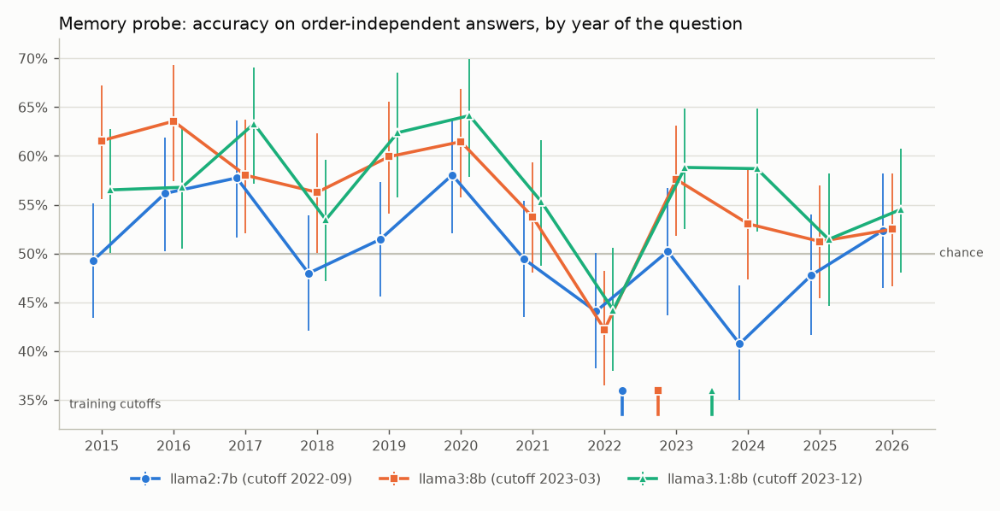

# Filing signals report (anon text, llama3.1:8b)

- Filings: 4466, with LLM score: 4349, companies: 100
- Sample: 2015-01-09 to 2026-11-12
- Model training cutoff: 2023-12-31
- Primary signal (declared in the configuration before any results were computed): `llm_score_chg`
- Entry lag: 1 trading day; one-way cost: 10 bps; quantiles: 5
- Share of each MD&A read by the LLM (first 3 chunks of 12,000 characters), median: 47% for 10-K, 67% for 10-Q

## Signals

- `llm_score`: LLM: mean of tone, outlook, demand, margins (level)
- `llm_score_chg`: LLM: change in llm_score vs the company's previous filing
- `llm_caution`: LLM: minus (liquidity stress + uncertainty)
- `sim_yoy`: Baseline: word-count similarity to the same filing a year earlier (Lazy Prices)
- `emb_sim_yoy`: Embeddings: whole-document similarity to the same filing a year earlier
- `emb_align_yoy`: Embeddings: passage-level match with the same filing a year earlier

## Rank IC against market-adjusted forward returns

Spearman correlation between the signal and the return, computed within each calendar quarter and then averaged across quarters. A |t| above about 2 is conventionally treated as significant. `se` is the standard error of the mean IC and `min_detectable_ic` (2.8 standard errors) is the smallest true IC this sample would detect with 80% power at the 5% level; a null result rules out larger effects, not smaller ones.

| signal | horizon | mean_ic | t_stat | quarters | se | min_detectable_ic |
|---|---|---|---|---|---|---|
| llm_score | 5 | -0.005 | -0.261 | 48 | 0.018 | 0.051 |
| llm_score | 21 | -0.007 | -0.364 | 47 | 0.020 | 0.057 |
| llm_score | 63 | 0.019 | 0.895 | 47 | 0.021 | 0.058 |
| llm_score_chg | 5 | 0.004 | 0.303 | 47 | 0.014 | 0.040 |
| llm_score_chg | 21 | -0.011 | -0.585 | 46 | 0.018 | 0.051 |
| llm_score_chg | 63 | 0.011 | 0.635 | 46 | 0.017 | 0.048 |
| llm_caution | 5 | 0.001 | 0.056 | 48 | 0.017 | 0.047 |
| llm_caution | 21 | 0.000 | 0.025 | 47 | 0.015 | 0.041 |
| llm_caution | 63 | -0.019 | -1.247 | 47 | 0.015 | 0.042 |
| sim_yoy | 5 | -0.006 | -0.361 | 44 | 0.018 | 0.049 |
| sim_yoy | 21 | -0.004 | -0.193 | 43 | 0.020 | 0.056 |
| sim_yoy | 63 | -0.003 | -0.132 | 43 | 0.025 | 0.069 |
| emb_sim_yoy | 5 | -0.009 | -0.499 | 44 | 0.017 | 0.049 |
| emb_sim_yoy | 21 | -0.026 | -1.167 | 43 | 0.022 | 0.062 |
| emb_sim_yoy | 63 | -0.031 | -1.337 | 43 | 0.023 | 0.065 |
| emb_align_yoy | 5 | -0.012 | -0.689 | 44 | 0.017 | 0.048 |
| emb_align_yoy | 21 | -0.001 | -0.070 | 43 | 0.018 | 0.051 |
| emb_align_yoy | 63 | 0.006 | 0.322 | 43 | 0.019 | 0.054 |

## Timing: returns before, around and after the filing

Rank IC of each signal against the market-adjusted return in three windows, shown as IC (t-statistic). `before_filing` is the 63 trading days that end the day before the filing; `filing_window` runs from the close before the filing to the entry close; `after_entry` is the 63 trading days after entry, the only window the strategy can earn. A signal that reflects information the market already has correlates with the first two windows and not the third.

| signal | period | before_filing | filing_window | after_entry |
|---|---|---|---|---|
| llm_score | full | 0.094 (4.3) | 0.051 (3.0) | 0.019 (0.9) |
| llm_score | pre_cutoff | 0.104 (3.8) | 0.075 (4.5) | 0.012 (0.5) |
| llm_score | post_cutoff | 0.063 (2.5) | -0.023 (-0.6) | 0.039 (0.9) |
| llm_score_chg | full | 0.067 (3.5) | 0.063 (4.0) | 0.011 (0.6) |
| llm_score_chg | pre_cutoff | 0.089 (3.8) | 0.077 (4.3) | 0.021 (1.0) |
| llm_score_chg | post_cutoff | 0.003 (0.1) | 0.021 (0.7) | -0.021 (-0.8) |
| llm_caution | full | 0.026 (1.8) | 0.012 (0.8) | -0.019 (-1.2) |
| llm_caution | pre_cutoff | 0.032 (1.8) | 0.028 (1.8) | -0.019 (-1.1) |
| llm_caution | post_cutoff | 0.006 (0.3) | -0.036 (-1.2) | -0.018 (-0.6) |
| sim_yoy | full | -0.003 (-0.1) | -0.006 (-0.4) | -0.003 (-0.1) |
| sim_yoy | pre_cutoff | -0.016 (-0.8) | -0.012 (-0.6) | -0.026 (-1.0) |
| sim_yoy | post_cutoff | 0.033 (1.1) | 0.009 (0.3) | 0.063 (1.1) |
| emb_sim_yoy | full | -0.011 (-0.6) | -0.003 (-0.2) | -0.031 (-1.3) |
| emb_sim_yoy | pre_cutoff | -0.032 (-1.6) | -0.002 (-0.1) | -0.056 (-2.2) |
| emb_sim_yoy | post_cutoff | 0.045 (1.1) | -0.005 (-0.2) | 0.042 (0.9) |
| emb_align_yoy | full | 0.030 (1.9) | 0.012 (0.6) | 0.006 (0.3) |
| emb_align_yoy | pre_cutoff | 0.032 (1.7) | 0.000 (0.0) | -0.009 (-0.4) |
| emb_align_yoy | post_cutoff | 0.023 (0.7) | 0.042 (1.4) | 0.049 (1.3) |

## Long-short portfolios (monthly, net of costs)

Top-minus-bottom quantile portfolios. Companies with equal scores are split evenly across a quantile boundary.

### `llm_score`

| period | months | ann_return | ann_vol | sharpe | t_stat | hit_rate | max_drawdown |
|---|---|---|---|---|---|---|---|
| full | 142 | 0.032 | 0.113 | 0.283 | 0.974 | 0.535 | -0.267 |
| pre_cutoff | 107 | 0.000 | 0.109 | 0.004 | 0.011 | 0.514 | -0.267 |
| post_cutoff | 35 | 0.129 | 0.123 | 1.046 | 1.787 | 0.600 | -0.061 |

Average monthly turnover: 0.87 (2.0 = both legs fully replaced).

### `llm_score_chg`

| period | months | ann_return | ann_vol | sharpe | t_stat | hit_rate | max_drawdown |
|---|---|---|---|---|---|---|---|
| full | 139 | -0.017 | 0.096 | -0.180 | -0.613 | 0.468 | -0.404 |
| pre_cutoff | 104 | -0.034 | 0.098 | -0.347 | -1.020 | 0.462 | -0.404 |
| post_cutoff | 35 | 0.032 | 0.091 | 0.351 | 0.599 | 0.486 | -0.160 |

Average monthly turnover: 1.49 (2.0 = both legs fully replaced).

### `llm_caution`

| period | months | ann_return | ann_vol | sharpe | t_stat | hit_rate | max_drawdown |
|---|---|---|---|---|---|---|---|
| full | 142 | -0.036 | 0.075 | -0.484 | -1.666 | 0.415 | -0.444 |
| pre_cutoff | 107 | -0.035 | 0.066 | -0.533 | -1.591 | 0.430 | -0.327 |
| post_cutoff | 35 | -0.039 | 0.098 | -0.401 | -0.685 | 0.371 | -0.174 |

Average monthly turnover: 0.76 (2.0 = both legs fully replaced).

### `sim_yoy`

| period | months | ann_return | ann_vol | sharpe | t_stat | hit_rate | max_drawdown |
|---|---|---|---|---|---|---|---|
| full | 130 | -0.048 | 0.146 | -0.329 | -1.082 | 0.492 | -0.585 |
| pre_cutoff | 95 | -0.043 | 0.107 | -0.403 | -1.133 | 0.484 | -0.419 |
| post_cutoff | 35 | -0.062 | 0.222 | -0.278 | -0.474 | 0.514 | -0.465 |

Average monthly turnover: 0.77 (2.0 = both legs fully replaced).

### `emb_sim_yoy`

| period | months | ann_return | ann_vol | sharpe | t_stat | hit_rate | max_drawdown |
|---|---|---|---|---|---|---|---|
| full | 130 | -0.075 | 0.137 | -0.546 | -1.796 | 0.431 | -0.657 |
| pre_cutoff | 95 | -0.063 | 0.114 | -0.559 | -1.573 | 0.400 | -0.507 |
| post_cutoff | 35 | -0.105 | 0.188 | -0.559 | -0.955 | 0.514 | -0.434 |

Average monthly turnover: 0.78 (2.0 = both legs fully replaced).

### `emb_align_yoy`

| period | months | ann_return | ann_vol | sharpe | t_stat | hit_rate | max_drawdown |
|---|---|---|---|---|---|---|---|
| full | 130 | -0.008 | 0.114 | -0.069 | -0.229 | 0.531 | -0.375 |
| pre_cutoff | 95 | 0.001 | 0.091 | 0.008 | 0.024 | 0.526 | -0.166 |
| post_cutoff | 35 | -0.032 | 0.164 | -0.193 | -0.329 | 0.543 | -0.375 |

Average monthly turnover: 0.79 (2.0 = both legs fully replaced).

## Leakage: memory probe (no filing text given)

Each model is given two company names and a date, with no filing text, and asked which stock had the higher return over the following three months. The same 4,775 pairs, an equal number from every calendar year, are put to every model in both orders. `order_independent` is the share of pairs on which the model named the same company both times; `accuracy` is measured on those pairs (`n`), so a preference for one position cannot affect it. `accuracy_all_pairs` counts a pair with conflicting answers as half right. A pair is pre-cutoff when its whole three-month window ends before the model's training cutoff and post-cutoff when the question date is after it.

| model | cutoff | period | pairs | order_independent | n | accuracy | z_vs_50pct | accuracy_all_pairs |
|---|---|---|---|---|---|---|---|---|
| llama2:7b | 2022-09-30 | pre_cutoff | 2985 | 0.678 | 2025 | 0.520 | 1.800 | 0.514 |
| llama2:7b | 2022-09-30 | post_cutoff | 1683 | 0.638 | 1073 | 0.477 | -1.496 | 0.485 |
| llama3:8b | 2023-03-31 | pre_cutoff | 3152 | 0.681 | 2146 | 0.569 | 6.433 | 0.547 |
| llama3:8b | 2023-03-31 | post_cutoff | 1480 | 0.724 | 1071 | 0.528 | 1.803 | 0.520 |
| llama3.1:8b | 2023-12-31 | pre_cutoff | 3498 | 0.591 | 2067 | 0.572 | 6.577 | 0.543 |
| llama3.1:8b | 2023-12-31 | post_cutoff | 1192 | 0.561 | 669 | 0.550 | 2.590 | 0.528 |

Memorised outcomes would show as accuracy above 50% before a model's cutoff that falls to 50% after it, with the fall occurring at a different date for each model.

Accuracy on order-independent answers by year of the question, with the number of such answers in brackets:

| year | llama2:7b | llama3:8b | llama3.1:8b |
|---|---|---|---|
| 2015 | 0.493 (278) | 0.616 (268) | 0.565 (230) |
| 2016 | 0.562 (276) | 0.636 (247) | 0.568 (243) |
| 2017 | 0.578 (258) | 0.580 (274) | 0.633 (248) |
| 2018 | 0.480 (273) | 0.563 (247) | 0.535 (245) |
| 2019 | 0.515 (274) | 0.599 (277) | 0.624 (218) |
| 2020 | 0.581 (267) | 0.615 (288) | 0.641 (237) |
| 2021 | 0.494 (265) | 0.537 (294) | 0.553 (226) |
| 2022 | 0.441 (270) | 0.422 (270) | 0.442 (233) |
| 2023 | 0.502 (223) | 0.576 (290) | 0.588 (238) |
| 2024 | 0.408 (265) | 0.530 (296) | 0.587 (230) |
| 2025 | 0.478 (249) | 0.512 (283) | 0.515 (206) |
| 2026 | 0.524 (273) | 0.525 (282) | 0.545 (233) |

The controls separate date-specific memory from a general preference for certain companies. `picks_larger` is the share of answers that chose the company that is larger today; `larger_wins` is the accuracy of always choosing the larger company; `acc_when_smaller` is the accuracy when the model chose the smaller company; `placebo_accuracy` scores the model's choice against the same pair's outcome at every other month-end in the period, and so shows how much accuracy remains when the date is wrong.

| model | period | accuracy | placebo_accuracy | picks_larger | larger_wins | n_picked_smaller | acc_when_smaller | z_when_smaller |
|---|---|---|---|---|---|---|---|---|
| llama2:7b | pre_cutoff | 0.520 | 0.510 | 0.626 | 0.526 | 758 | 0.480 | -1.090 |
| llama2:7b | post_cutoff | 0.477 | 0.494 | 0.596 | 0.521 | 433 | 0.464 | -1.490 |
| llama3:8b | pre_cutoff | 0.569 | 0.543 | 0.569 | 0.525 | 924 | 0.550 | 3.027 |
| llama3:8b | post_cutoff | 0.528 | 0.518 | 0.525 | 0.520 | 509 | 0.497 | -0.133 |
| llama3.1:8b | pre_cutoff | 0.572 | 0.548 | 0.523 | 0.525 | 985 | 0.540 | 2.517 |
| llama3.1:8b | post_cutoff | 0.550 | 0.524 | 0.499 | 0.519 | 335 | 0.519 | 0.710 |

## Leakage: identity probe on anonymised text (n=290)

Share of anonymised MD&A excerpts for which the model named the correct company and fiscal year.

| metric | share |
|---|---|
| company_correct | 0.824 |
| year_correct | 0.224 |
| year_within_1 | 0.448 |

## Leakage: raw versus anonymised scores

Each filing was scored twice: as filed, and with the company name, ticker and years masked. `gap` is the mean of the raw score minus the anonymised score (`llm_score` ranges from -2 to 2).

| signal | n | correlation | gap_pre | t_pre | gap_post | t_post |
|---|---|---|---|---|---|---|
| llm_score | 4349 | 0.944 | -0.009 | -2.490 | 0.000 | 0.029 |
| llm_score_chg | 4249 | 0.858 | 0.000 | -0.074 | 0.005 | 0.618 |
| llm_caution | 4349 | 0.890 | 0.001 | 0.234 | 0.001 | 0.117 |

Rank IC of the gap in `llm_score` against market-adjusted forward returns. If the model had shifted its scores towards outcomes it had memorised, the IC would be positive before the cutoff and close to zero after it.

| period | horizon | mean_ic | t_stat | quarters |
|---|---|---|---|---|
| pre_cutoff | 5 | -0.027 | -1.822 | 36 |
| pre_cutoff | 21 | -0.032 | -1.582 | 36 |
| pre_cutoff | 63 | -0.018 | -1.178 | 36 |
| post_cutoff | 5 | 0.012 | 0.402 | 12 |
| post_cutoff | 21 | 0.037 | 1.274 | 11 |
| post_cutoff | 63 | 0.033 | 1.065 | 11 |

## Robustness: entry lag and trading cost

Full-sample net Sharpe ratio of each long-short portfolio. Lag 0 trades at the close of the filing day, which is not achievable for filings released after the close, so it is an upper bound.

By entry lag (trading days after the filing date, 10 bps cost):

| signal | lag_0 | lag_1 | lag_2 | lag_5 |
|---|---|---|---|---|
| llm_score | 0.289 | 0.283 | 0.326 | 0.374 |
| llm_score_chg | -0.059 | -0.180 | -0.172 | -0.041 |
| llm_caution | -0.452 | -0.484 | -0.624 | -0.631 |
| sim_yoy | -0.362 | -0.329 | -0.389 | -0.378 |
| emb_sim_yoy | -0.559 | -0.546 | -0.602 | -0.616 |
| emb_align_yoy | -0.077 | -0.069 | -0.099 | -0.101 |

By one-way cost (entry lag 1):

| signal | 0_bps | 10_bps | 25_bps |
|---|---|---|---|
| llm_score | 0.375 | 0.283 | 0.145 |
| llm_score_chg | 0.006 | -0.180 | -0.457 |
| llm_caution | -0.361 | -0.484 | -0.669 |
| sim_yoy | -0.267 | -0.329 | -0.421 |
| emb_sim_yoy | -0.479 | -0.546 | -0.645 |
| emb_align_yoy | 0.014 | -0.069 | -0.194 |
